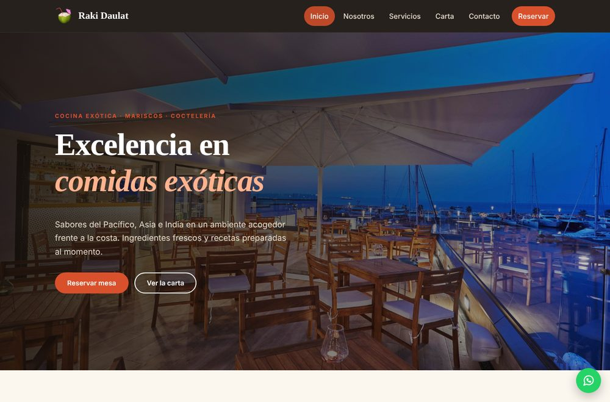
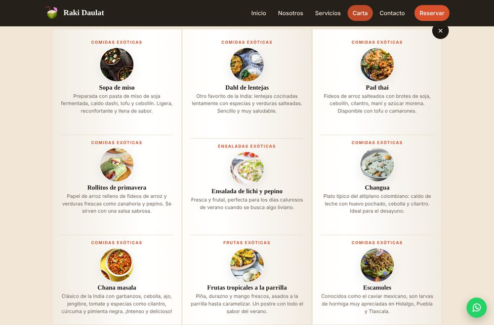
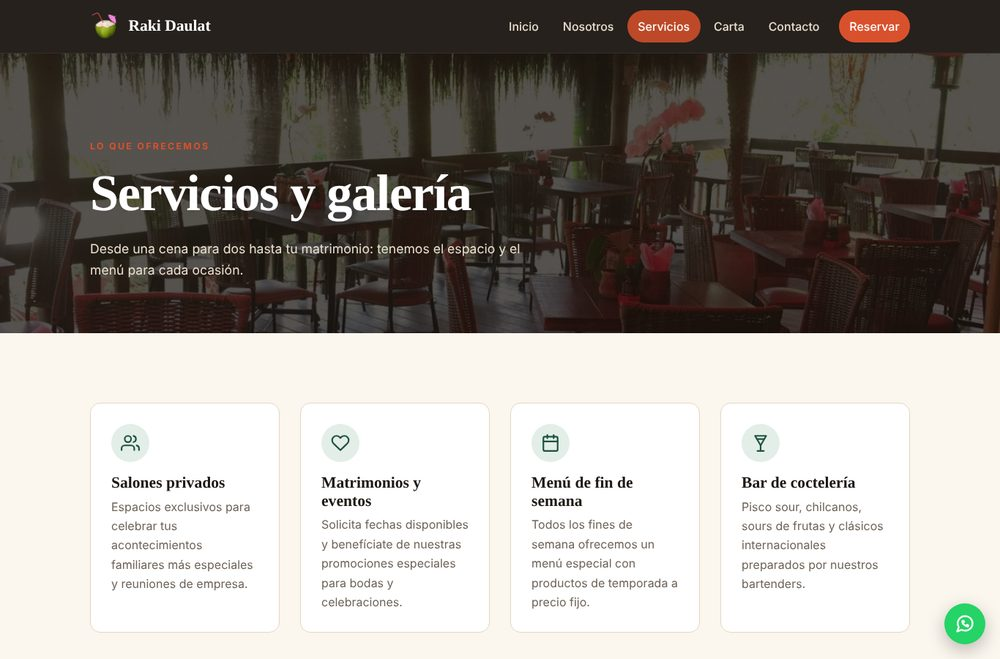
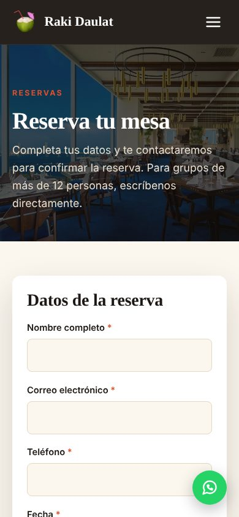

# Raki Daulat — Sitio web de restaurante

[](https://github.com/Omega-kobra-Ariel-Rivera/raki-daulat/actions/workflows/ci.yml)


Sitio web responsive para **Raki Daulat**, un restaurante de comida exótica, mariscos y coctelería.
Incluye carta interactiva tipo libro, galería de platos con filtros, formulario de contacto y
sistema de reservas en línea con backend en PHP y base de datos PostgreSQL.



## Características

- **6 páginas**: Inicio, Nosotros, Servicios (con galería), Carta, Contacto y Reservas, más página 404.
- **Diseño responsive** para móvil, tablet y escritorio, con menú adaptable.
- **Carta tipo libro** con animación 3D de apertura (en móvil se muestra en formato lista).
- **Galería** filtrable por categoría (cócteles, entradas, fondos, postres) con visor de imágenes.
- **Reservas en línea** con validación en el navegador y en el servidor:
  no se aceptan fechas pasadas, lunes (día de cierre), horas fuera de horario ni más de 12 personas.
- **Formulario de contacto** que guarda los mensajes en la base de datos.
- **Respaldo por WhatsApp**: si el sitio se publica sin PHP (por ejemplo en GitHub Pages),
  los formularios ofrecen enviar la solicitud por WhatsApp con los datos ya escritos.
- **Seguridad**: consultas preparadas (sin inyección SQL), credenciales en variables de entorno,
  campo anti-spam (honeypot), cabeceras de seguridad y archivos internos bloqueados vía `.htaccess`.
- **Accesibilidad**: HTML semántico, textos alternativos, navegación con teclado, mensajes de error
  asociados a cada campo y respeto por `prefers-reduced-motion`.
- **Sin dependencias**: CSS y JavaScript propios, sin frameworks; imágenes optimizadas (≈3 MB en total).

| Carta interactiva | Galería | Reservas (móvil) |
| --- | --- | --- |
|  |  |  |

## Tecnologías

| Capa | Tecnología |
| --- | --- |
| Frontend | HTML5, CSS3 (Grid, Flexbox, variables CSS), JavaScript (ES5+, sin librerías) |
| Backend | PHP 8.1+ con PDO |
| Base de datos | PostgreSQL 13+ |
| Entorno local | Docker y Docker Compose (opcional) |
| CI | GitHub Actions |

## Estructura del proyecto

```
raki-daulat/
├── index.html            # Inicio
├── nosotros.html         # Historia y valores
├── servicios.html        # Servicios y galería de platos
├── carta.html            # Carta tipo libro
├── contacto.html         # Formulario de contacto
├── reserva.html          # Formulario de reservas
├── 404.html              # Página no encontrada
├── assets/
│   ├── css/              # main.css (global) y carta.css
│   ├── js/main.js        # Menú, galería, carta y formularios
│   └── img/              # logo, local/, platos/, carta/
├── api/
│   ├── _bootstrap.php    # Configuración, conexión y utilidades
│   ├── contacto.php      # POST: guarda mensajes de contacto
│   └── reserva.php       # POST: registra reservas
├── database/schema.sql   # Tablas contactos y reservas
├── tests/                # Pruebas de enlaces y de la API
├── docs/                 # Capturas de pantalla
├── .env.example          # Plantilla de configuración
├── Dockerfile
└── docker-compose.yml
```

## Cómo ejecutarlo

### Opción 1: solo el sitio (sin base de datos)

Abre `index.html` en el navegador, o levanta un servidor local:

```bash
python3 -m http.server 8000
# Abrir http://localhost:8000
```

Los formularios mostrarán la opción de enviar por WhatsApp, ya que no hay backend.

### Opción 2: con Docker (sitio + PHP + PostgreSQL)

```bash
cp .env.example .env        # edita DB_PASSWORD
docker compose up --build
# Abrir http://localhost:8080
```

La base de datos se crea automáticamente con `database/schema.sql`.

### Opción 3: PHP y PostgreSQL instalados en tu equipo

```bash
cp .env.example .env                                   # completa tus credenciales
createdb -U postgres raki_daulat
psql -U postgres -d raki_daulat -f database/schema.sql
php -S localhost:8000
```

Requiere PHP 8.1 o superior con la extensión `pdo_pgsql` habilitada.

## API

Ambos endpoints reciben `POST` (formulario `multipart/form-data` o `x-www-form-urlencoded`)
y responden JSON `{ "ok": bool, "message": string, "errors"?: { campo: mensaje } }`.

| Endpoint | Campos | Respuestas |
| --- | --- | --- |
| `api/contacto.php` | `nombre`, `correo`, `telefono` (opcional), `mensaje` | `201` creado · `422` datos inválidos · `405` método no permitido |
| `api/reserva.php` | `nombre`, `correo`, `telefono`, `fecha` (AAAA-MM-DD), `hora` (HH:MM), `personas` (1-12), `comentarios` (opcional) | `201` · `422` · `405` |

Para revisar las reservas recibidas:

```sql
SELECT fecha, hora, nombre, personas, telefono, estado
FROM reservas
WHERE fecha >= CURRENT_DATE
ORDER BY fecha, hora;
```

## Pruebas

```bash
python3 tests/check_links.py                               # enlaces e imágenes rotas
BASE_URL=http://localhost:8000 bash tests/api_test.sh      # API (requiere PHP + BD)
```

Las mismas pruebas se ejecutan automáticamente en GitHub Actions en cada `push`.

## Publicación

- **GitHub Pages / Netlify**: publica la carpeta tal cual. El sitio funciona completo y los
  formularios usan el respaldo por WhatsApp.
- **Hosting con PHP** (cPanel, Hostinger, etc.): sube los archivos, crea la base de datos con
  `database/schema.sql` y crea el archivo `.env` en el servidor con tus credenciales.

## Personalización

Los datos de contacto (dirección, teléfono, correo, WhatsApp) son **de demostración**.
Para cambiarlos, busca y reemplaza en los archivos `.html` y en `assets/js/main.js`
(constante `WHATSAPP`). El horario se valida también en `api/reserva.php`.

## Historial

| Fecha | Versión |
| --- | --- |
| 4 de mayo de 2024 | Primera versión: mi primera página web (HTML, CSS, Bootstrap y PHP). |
| Octubre de 2026 | Rediseño completo: diseño responsive, carta interactiva, reservas en línea, API segura, Docker y pruebas automáticas. |

## Autor

**Ariel Rivera** — Técnico en Programación y Análisis de Sistemas
GitHub: [@Omega-kobra-Ariel-Rivera](https://github.com/Omega-kobra-Ariel-Rivera)

## Licencia

Código bajo licencia [MIT](LICENSE). Las fotografías de platos y locales se usan con fines
demostrativos y pertenecen a sus respectivos autores.
